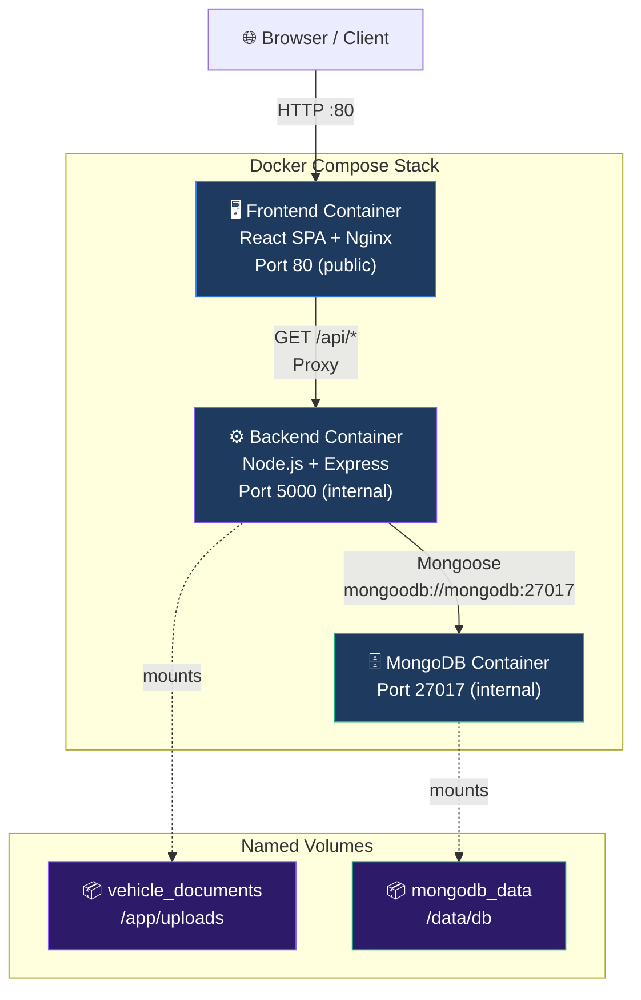

# VehicleVault 🚗 — Vehicle Document Management System

> **A complete MERN stack application demonstrating Docker volume persistence and production deployment.**
> Built for Assignment 1 (Document Upload Persistence) and Assignment 2 (Production MERN Architecture).

---

## ⚠️ Security Limitation

**VehicleVault is an unauthenticated MVP for learning and demonstration.** Any user with network access to the application can read, create, update, and delete all data. Do not expose this application to the public internet without first adding user authentication, authorisation, input sanitisation, and HTTPS.

---

## Table of Contents

1. [Project Overview](#1-project-overview)
2. [Architecture Diagram](#2-architecture-diagram)
3. [Technology Stack](#3-technology-stack)
4. [Directory Structure](#4-directory-structure)
5. [Prerequisites](#5-prerequisites)
6. [Environment Configuration](#6-environment-configuration)
7. [Local Development (without Docker)](#7-local-development-without-docker)
8. [Building Docker Images](#8-building-docker-images)
9. [Starting with Docker Compose](#9-starting-with-docker-compose)
10. [Application URLs](#10-application-urls)
11. [Vehicle Management](#11-vehicle-management)
12. [PDF Upload and Download](#12-pdf-upload-and-download)
13. [Named Volume Explanation](#13-named-volume-explanation)
14. [Document Persistence Experiment (Assignment 1)](#14-document-persistence-experiment-assignment-1)
15. [MongoDB Persistence Verification](#15-mongodb-persistence-verification)
16. [Nginx Reverse Proxy](#16-nginx-reverse-proxy)
17. [HTTPS Configuration](#17-https-configuration)
18. [AWS EC2 Deployment](#18-aws-ec2-deployment)
19. [Logs and Statistics](#19-logs-and-statistics)
20. [Backup and Restore](#20-backup-and-restore)
21. [Troubleshooting](#21-troubleshooting)
22. [Security Limitations](#22-security-limitations)
23. [Acceptance Checklist](#23-acceptance-checklist)

---

## 1. Project Overview

VehicleVault is a full-stack web application that allows users to:

- Register and manage vehicles (CRUD).
- Upload PDF documents (insurance, registration certificates, pollution certificates, etc.) linked to vehicles.
- Track document expiry dates with visual alerts.
- Download stored PDFs through a secure API endpoint.
- Monitor application and database health.

The project demonstrates two key DevOps concepts:

- **Assignment 1:** PDF files uploaded to the backend survive Docker container deletion and recreation via a named Docker volume (`vehicle_documents`).
- **Assignment 2:** A production-oriented MERN deployment using Docker Compose with persistent named volumes, Nginx reverse proxy, environment variable configuration, and an AWS EC2-ready architecture.

---

## 2. Architecture Diagram



---

## 3. Technology Stack

| Layer | Technology |
|---|---|
| Frontend framework | React 18 + Vite |
| Frontend routing | React Router v6 |
| HTTP client | Axios |
| Styling | Vanilla CSS (dark theme, glassmorphism) |
| Backend framework | Node.js + Express |
| Database ORM | Mongoose |
| File uploads | Multer |
| Database | MongoDB 7.0 |
| Reverse proxy | Nginx 1.27 |
| Containerisation | Docker + Docker Compose v2 |
| Environment config | dotenv + `.env` |
| Testing | Jest + Supertest |
| Production process | Node.js (no PM2 needed inside Docker) |

---

## 4. Directory Structure

```
VehicleVault/
├── frontend/
│   ├── src/
│   │   ├── components/       # Sidebar, Modal, Alert, StatCard
│   │   ├── pages/            # Dashboard, Vehicles, Documents, SystemStatus
│   │   ├── services/
│   │   │   └── api.js        # Axios API wrapper (relative /api URLs)
│   │   ├── App.jsx
│   │   ├── main.jsx
│   │   └── index.css         # Global CSS design system
│   ├── nginx/
│   │   └── default.conf      # Nginx config baked into the frontend image
│   ├── Dockerfile            # Multi-stage: Node build → Nginx runtime
│   ├── .dockerignore
│   ├── vite.config.js
│   └── package.json
├── backend/
│   ├── src/
│   │   ├── config/
│   │   │   └── index.js      # Centralised env config
│   │   ├── models/
│   │   │   ├── Vehicle.js    # Mongoose Vehicle model
│   │   │   └── Document.js   # Mongoose Document model
│   │   ├── middleware/
│   │   │   ├── errorHandler.js      # Centralized error handler
│   │   │   └── validateObjectId.js  # ObjectId guard middleware
│   │   ├── routes/
│   │   │   ├── health.js     # GET /api/health
│   │   │   ├── vehicles.js   # CRUD /api/vehicles
│   │   │   ├── documents.js  # Upload/download/delete /api/documents
│   │   │   └── dashboard.js  # GET /api/dashboard/stats
│   │   ├── services/
│   │   │   ├── fileService.js    # Safe file ops + path traversal prevention
│   │   │   └── uploadService.js  # Multer + PDF magic byte check
│   │   ├── app.js            # Express app factory
│   │   └── server.js         # Entry point + MongoDB connection + graceful shutdown
│   ├── tests/
│   │   ├── setup.js          # Jest global setup (temp DB + temp upload dir)
│   │   ├── health.test.js
│   │   ├── vehicles.test.js
│   │   ├── documents.test.js
│   │   └── dashboard.test.js
│   ├── Dockerfile            # Production Node.js image (non-root user)
│   ├── .dockerignore
│   └── package.json
├── deploy/
│   ├── nginx/
│   │   └── vehiclevault.conf # Production HTTPS Nginx (host-side config)
│   └── scripts/
│       └── deploy.sh         # EC2 deployment helper script
├── compose.yaml              # Docker Compose (3 services + 2 named volumes)
├── .env.example              # Documented env var placeholders
├── .gitignore
└── README.md
```

---

## 5. Prerequisites

**For Docker deployment (recommended):**
- Docker Engine 24+ and Docker Compose v2 (`docker compose` command)
- Git

**For local development (no Docker):**
- Node.js 18 LTS or later
- MongoDB 7.0 (local or MongoDB Atlas)

---

## 6. Environment Configuration

```bash
# Copy the example file
cp .env.example .env

# Edit .env and set strong credentials
nano .env   # or use any text editor
```

**Key variables in `.env`:**

| Variable | Description |
|---|---|
| `MONGO_INITDB_ROOT_USERNAME` | MongoDB root username |
| `MONGO_INITDB_ROOT_PASSWORD` | MongoDB root password (use a strong random value) |
| `MONGO_DB_NAME` | Application database name (default: `vehiclevault`) |
| `UPLOAD_DIR` | PDF upload path inside the backend container (default: `/app/uploads`) |
| `MAX_UPLOAD_SIZE_MB` | Maximum PDF size in MB (default: `10`) |
| `HOST_PORT` | Host port for Nginx (default: `80`) |

**Generating a strong password (Linux/macOS):**
```bash
openssl rand -base64 32
```

> `.env` is listed in `.gitignore` — never commit it. Use a secrets manager for production.

---

## 7. Local Development (without Docker)

**Terminal 1 — Start MongoDB:**
```bash
mongod --dbpath /tmp/vvdata
```

**Terminal 2 — Start backend:**
```bash
cd backend
npm install
NODE_ENV=development MONGODB_URI=mongodb://localhost:27017/vehiclevault_dev UPLOAD_DIR=./uploads npm run dev
```

**Terminal 3 — Start frontend (Vite dev server with API proxy):**
```bash
cd frontend
npm install
npm run dev
# Open http://localhost:5173
```

---

## 8. Building Docker Images

Build both images without starting containers:

```bash
# From the VehicleVault/ directory
docker compose build

# Build with no cache (clean rebuild)
docker compose build --no-cache
```

Inspect image sizes:
```bash
docker images | grep vehiclevault
```

---

## 9. Starting with Docker Compose

```bash
# Ensure .env exists with your credentials
cp .env.example .env   # then edit it

# Build images and start all services in the background
docker compose up --build -d

# Check that all three services are healthy
docker compose ps

# Watch startup logs (Ctrl+C to stop following)
docker compose logs -f
```

**Stopping (data is preserved):**
```bash
docker compose down
# Named volumes are NOT deleted. Data is safe.
```

**⚠️ DO NOT run `docker compose down -v` during ordinary use — it deletes named volumes and all data.**

---

## 10. Application URLs

| URL | Description |
|---|---|
| `http://localhost/` | VehicleVault web application |
| `http://localhost/dashboard` | Dashboard page |
| `http://localhost/vehicles` | Vehicle management |
| `http://localhost/documents` | Document upload and management |
| `http://localhost/status` | System Status page |
| `http://localhost/api/health` | API health check (JSON) |
| `http://localhost/api/vehicles` | Vehicles REST API |
| `http://localhost/api/documents` | Documents REST API |
| `http://localhost/api/dashboard/stats` | Dashboard stats API |

---

## 11. Vehicle Management

**Create a vehicle (API):**
```bash
curl -s -X POST http://localhost/api/vehicles \
  -H 'Content-Type: application/json' \
  -d '{"registrationNumber":"MH01AB1234","make":"Toyota","model":"Camry","year":2022}' | jq
```

**List vehicles:**
```bash
curl -s http://localhost/api/vehicles | jq
```

**Update:**
```bash
curl -s -X PUT http://localhost/api/vehicles/<id> \
  -H 'Content-Type: application/json' \
  -d '{"notes":"Updated notes"}' | jq
```

**Delete:**
```bash
curl -s -X DELETE http://localhost/api/vehicles/<id> | jq
```

---

## 12. PDF Upload and Download

**Upload a PDF (API):**
```bash
curl -s -X POST http://localhost/api/documents \
  -F "file=@/path/to/document.pdf" \
  -F "title=Annual Insurance" \
  -F "documentType=Insurance" \
  -F "vehicleId=<vehicle-id>" | jq
```

**List documents:**
```bash
curl -s http://localhost/api/documents | jq
```

**Download a PDF:**
```bash
curl -s -o downloaded.pdf http://localhost/api/documents/<doc-id>/download
```

**Delete a document:**
```bash
curl -s -X DELETE http://localhost/api/documents/<doc-id> | jq
```

---

## 13. Named Volume Explanation

### Container Filesystem vs Named Volume

**Container's Writable Filesystem Layer:**
Every container has a temporary writable layer on top of its image. When you delete a container (`docker rm`), this writable layer is permanently destroyed. Any files written inside the container that are NOT in a volume are lost.

**Named Docker Volume:**
A named volume (e.g., `vehicle_documents`) is a persistent storage location managed by Docker, stored in Docker's volume store on the host machine. It is:
- **Independent of container lifecycle** — deleting a container does NOT delete the volume.
- **Independent of image rebuilds** — building a new image does NOT touch the volume.
- **Mounted into the container** at runtime — the container reads and writes to it as if it were a local directory.

### VehicleVault Volumes

| Volume Name | Container Mount | Purpose |
|---|---|---|
| `vehicle_documents` | `/app/uploads` (backend) | Uploaded PDF files |
| `mongodb_data` | `/data/db` (mongodb) | MongoDB data files |

Inspect volume details:
```bash
docker volume ls
docker volume inspect vehiclevault_vehicle_documents
docker volume inspect vehiclevault_mongodb_data
```

---

## 14. Document Persistence Experiment (Assignment 1)

This procedure verifies that uploaded PDFs survive backend container recreation.

### Step 1 — Start the stack
```bash
docker compose up --build -d
docker compose ps   # All three services must be healthy
```

### Step 2 — Register a test vehicle
```bash
VEHICLE=$(curl -s -X POST http://localhost/api/vehicles \
  -H 'Content-Type: application/json' \
  -d '{"registrationNumber":"TEST001","make":"Persistence","model":"Test","year":2024}')
echo $VEHICLE | jq
VEHICLE_ID=$(echo $VEHICLE | jq -r '.vehicle._id')
echo "Vehicle ID: $VEHICLE_ID"
```

### Step 3 — Upload a test PDF
```bash
# Create a minimal valid PDF for testing
printf '%PDF-1.4\n1 0 obj\n<</Type /Catalog>>\nendobj\n%%%%EOF\n' > /tmp/test.pdf

UPLOAD=$(curl -s -X POST http://localhost/api/documents \
  -F "file=@/tmp/test.pdf" \
  -F "title=Persistence Test Document" \
  -F "documentType=Insurance" \
  -F "vehicleId=$VEHICLE_ID")
echo $UPLOAD | jq
DOC_ID=$(echo $UPLOAD | jq -r '.document._id')
STORED_NAME=$(echo $UPLOAD | jq -r '.document.storedFilename')
echo "Document ID: $DOC_ID"
echo "Stored filename: $STORED_NAME"
```

### Step 4 — Record the checksum
```bash
# Get the checksum of the file inside the container
docker exec vehiclevault-backend sh -c "sha256sum /app/uploads/$STORED_NAME"
```

### Step 5 — Confirm the file exists inside the container
```bash
docker exec vehiclevault-backend ls -lh /app/uploads/
```

### Step 6 — Recreate the backend container (WITHOUT deleting the volume)
```bash
# Stop and remove only the backend container
docker compose stop backend
docker compose rm -f backend

# Confirm the container is gone but the volume still exists
docker ps -a | grep backend
docker volume ls | grep vehicle_documents
```

### Step 7 — Verify the volume still holds the file
```bash
# Inspect the volume mount point on the host
docker volume inspect vehiclevault_vehicle_documents
# Note the 'Mountpoint' path and check the file there (Linux host)
# On Linux:
# ls -lh $(docker volume inspect vehiclevault_vehicle_documents --format '{{.Mountpoint}}')
```

### Step 8 — Restart the backend and re-verify
```bash
docker compose up -d backend
docker compose ps

# Confirm the file is still accessible inside the new container
docker exec vehiclevault-backend sh -c "sha256sum /app/uploads/$STORED_NAME"
# Checksum must be identical to Step 4
```

### Step 9 — Download and verify the PDF
```bash
curl -s -o /tmp/downloaded.pdf http://localhost/api/documents/$DOC_ID/download
sha256sum /tmp/downloaded.pdf
# Must match the checksum from Step 4
```

### Step 10 — Verify MongoDB metadata is still available
```bash
curl -s http://localhost/api/documents/$DOC_ID | jq
# Must return the document metadata
```

---

## 15. MongoDB Persistence Verification

```bash
# Step 1 — Note current vehicle count
curl -s http://localhost/api/vehicles | jq '.count'

# Step 2 — Recreate the MongoDB container WITHOUT deleting the volume
docker compose stop mongodb
docker compose rm -f mongodb
docker compose up -d mongodb
docker compose ps

# Step 3 — Wait for MongoDB to become healthy
sleep 20

# Step 4 — Restart the backend (it needs to reconnect)
docker compose restart backend
sleep 15

# Step 5 — Verify data is still present
curl -s http://localhost/api/vehicles | jq '.count'
curl -s http://localhost/api/documents | jq '.count'
# Counts must match Step 1
```

---

## 16. Nginx Reverse Proxy

The **frontend container** runs Nginx which serves two purposes:

1. **Static file server** — serves the compiled React production build from `/usr/share/nginx/html`.
2. **API reverse proxy** — forwards any request starting with `/api/` to the backend container at `http://backend:5000`.

Key Nginx behaviours:
- **SPA fallback** — unknown paths (e.g., `/dashboard`, `/vehicles`) serve `index.html` so React Router handles routing client-side.
- **API requests are NOT served `index.html`** — `proxy_intercept_errors off` ensures API errors return the actual JSON error from Express.
- **Body size limit** — `client_max_body_size 15m` allows PDF uploads up to the configured limit.

---

## 17. HTTPS Configuration

### Local Development
HTTPS is not required for local development. Use `http://localhost`.

### Production (AWS EC2 + Let's Encrypt)

**Prerequisites:**
- A registered domain name (e.g., `vehiclevault.example.com`)
- An `A` DNS record pointing your domain to the EC2 public IP
- Ports 80 and 443 open in the EC2 Security Group

**Certificate issuance:**
```bash
# Install Certbot
sudo apt-get install -y certbot

# Stop Compose stack temporarily (frees port 80)
cd /opt/vehiclevault && docker compose down

# Issue certificate
sudo certbot certonly --standalone \
  -d vehiclevault.example.com \
  -d www.vehiclevault.example.com

# Certificates are stored at:
# /etc/letsencrypt/live/vehiclevault.example.com/fullchain.pem
# /etc/letsencrypt/live/vehiclevault.example.com/privkey.pem
```

**Enable HTTPS config:**
```bash
# Copy the production Nginx config
sudo cp deploy/nginx/vehiclevault.conf /etc/nginx/sites-available/vehiclevault
sudo ln -s /etc/nginx/sites-available/vehiclevault /etc/nginx/sites-enabled/

# Edit the config to use your real domain
sudo nano /etc/nginx/sites-available/vehiclevault

# Restart Compose on an internal port (e.g., 8080)
# Edit HOST_PORT=8080 in .env, then:
docker compose up -d

# Test and reload host Nginx
sudo nginx -t
sudo systemctl reload nginx
```

**Certificate renewal (automatic):**
```bash
# Certbot installs a systemd timer or cron job automatically.
# Test renewal:
sudo certbot renew --dry-run
```

**Verify HTTPS:**
```bash
curl -I https://vehiclevault.example.com/api/health
# Look for: HTTP/2 200 and the HSTS header
```

> **Do not invent a domain or certificate.** HTTPS is documented here but cannot be demonstrated without a real registered domain pointing to a live EC2 instance.

---

## 18. AWS EC2 Deployment

### Instance Preparation

1. **Launch EC2 instance** — Ubuntu 22.04 LTS, `t3.small` or larger
2. **Security Group rules:**
   - Inbound TCP 80 from `0.0.0.0/0` (HTTP)
   - Inbound TCP 443 from `0.0.0.0/0` (HTTPS)
   - Inbound TCP 22 from your trusted IP only
   - **No inbound rules for 27017 (MongoDB) or 5000 (backend)**

### Quick Deploy

```bash
# SSH to your instance
ssh -i your-key.pem ubuntu@<EC2-PUBLIC-IP>

# Download and run the deployment script
curl -fsSL https://raw.githubusercontent.com/yourorg/vehiclevault/main/deploy/scripts/deploy.sh | bash
```

Or manually:
```bash
git clone https://github.com/yourorg/vehiclevault.git /opt/vehiclevault
cd /opt/vehiclevault
cp .env.example .env
nano .env   # Set strong credentials
docker compose up --build -d
```

### Container Restart After Reboot

All services use `restart: unless-stopped` — they restart automatically after `docker compose up -d` is run once. Docker Engine also starts automatically on system boot.

### Update Procedure
```bash
cd /opt/vehiclevault
git pull
docker compose up --build -d
docker compose ps
```

### Rollback
```bash
git checkout <previous-tag>
docker compose up --build -d
```

---

## 19. Logs and Statistics

### Container Status
```bash
# List all containers and their health
docker compose ps
```

### Service Logs
```bash
# All services (recent + follow)
docker compose logs -f

# Individual services
docker compose logs -f frontend
docker compose logs -f backend
docker compose logs -f mongodb

# Last N lines
docker compose logs --tail=100 backend
```

### Resource Statistics
```bash
# Live resource usage for all Compose containers
docker compose stats

# All running containers on the host
docker stats

# CPU, memory, network, I/O for a specific container
docker stats vehiclevault-backend
```

### Volume Inspection
```bash
docker volume ls
docker volume inspect vehiclevault_vehicle_documents
docker volume inspect vehiclevault_mongodb_data
```

### Compose Configuration
```bash
# Show the resolved Compose configuration (with env var substitution)
docker compose config
```

### Container Inspection
```bash
docker inspect vehiclevault-backend
docker inspect vehiclevault-frontend
docker inspect vehiclevault-mongodb
```

### Difference: Running vs Ready
`docker compose ps` shows whether a container is **running**. However, a running container is not necessarily **ready** to serve requests — MongoDB takes time to initialise, and the backend waits for MongoDB before accepting connections. The health checks in `compose.yaml` report the actual readiness state. Wait until all services show `healthy` before testing.

---

## 20. Backup and Restore

> Named volumes are persistent local storage — they are NOT a substitute for backups.

### Backup Documents Volume
```bash
docker run --rm \
  -v vehiclevault_vehicle_documents:/src \
  -v /backup:/dest \
  alpine tar czf /dest/uploads-$(date +%Y%m%d).tar.gz -C /src .
```

### Restore Documents Volume
```bash
docker run --rm \
  -v vehiclevault_vehicle_documents:/dest \
  -v /backup:/src \
  alpine tar xzf /src/uploads-20241020.tar.gz -C /dest
```

### Backup MongoDB Volume
```bash
docker run --rm \
  -v vehiclevault_mongodb_data:/src \
  -v /backup:/dest \
  alpine tar czf /dest/mongodb-$(date +%Y%m%d).tar.gz -C /src .
```

### Database Dump (preferred for MongoDB)
```bash
docker exec vehiclevault-mongodb \
  mongodump --username $MONGO_USER --password $MONGO_PASS \
  --authenticationDatabase admin --db vehiclevault \
  --archive > /backup/vehiclevault-$(date +%Y%m%d).dump
```

---

## 21. Troubleshooting

### Backend fails to start — "Could not connect to MongoDB"
```bash
docker compose logs mongodb    # Check MongoDB is healthy
docker compose logs backend    # Look for connection error messages
docker compose restart backend # After MongoDB is healthy
```

### Port 80 already in use
```bash
# Change HOST_PORT in .env (e.g., HOST_PORT=8081)
docker compose up -d
```

### Upload fails — "File Too Large"
Increase `MAX_UPLOAD_SIZE_MB` in `.env` and also `client_max_body_size` in `frontend/nginx/default.conf`, then rebuild.

### Permission denied on /app/uploads
```bash
docker exec vehiclevault-backend ls -la /app/
# The uploads directory should be owned by appuser
docker compose logs backend | grep fileService
```

### Database data appears lost after `down`
You ran `docker compose down -v`. This deletes named volumes. Use `docker compose down` (without `-v`) to preserve data.

### HTTPS certificate not working
- Verify the domain's A record resolves to your EC2 IP: `dig yourdomain.com`
- Ensure port 80 and 443 are open in the EC2 Security Group
- Check Certbot logs: `sudo journalctl -u certbot`

---

## 22. Security Limitations

| Limitation | Impact |
|---|---|
| No authentication | Any user can access all data |
| No authorisation | No role-based access control |
| Unauthenticated PDF download | Anyone can download any registered document |
| No audit logging | No record of who accessed or changed data |
| Single-user design | Not suitable for multi-tenant use |

**Mitigations required before production exposure:**
- Add JWT-based authentication (e.g., using `passport.js` or `express-jwt`)
- Implement per-user data isolation
- Add rate limiting on sensitive endpoints (already partially implemented)
- Enable HTTPS (see Section 17)
- Restrict CORS in production
- Add request validation with a library like `joi` or `zod`

---

## 23. Acceptance Checklist

### Assignment 1 — Document Upload Persistence

- [x] PDF documents uploaded through the web interface
- [x] Named volume `vehicle_documents` created in `compose.yaml`
- [x] Volume mounted at `/app/uploads` in the backend container
- [x] Named volume `mongodb_data` created for MongoDB
- [x] Backend container can be deleted and recreated without data loss
- [x] SHA-256 checksum verification procedure documented (Section 14)
- [x] MongoDB container can be recreated without metadata loss (Section 15)
- [x] Difference between container filesystem and named volume explained (Section 13)
- [ ] Persistence test actually executed and verified *(requires running Docker environment)*

### Assignment 2 — Production MERN Architecture

- [x] React frontend served through Nginx
- [x] Express API accessible under `/api`
- [x] MongoDB stores vehicle and document metadata with Mongoose
- [x] Nginx routes `/api/*` to backend; serves React SPA for other paths
- [x] Three-service `compose.yaml`: `frontend`, `backend`, `mongodb`
- [x] Internal Docker network — only frontend port exposed publicly
- [x] Named volumes for both data stores
- [x] Environment variables via `.env` file (`.env.example` provided)
- [x] Health checks on all three services
- [x] Restart policies (`unless-stopped`) on all services
- [x] `.env` in `.gitignore` — secrets not committed
- [x] Backend and MongoDB not publicly exposed
- [x] `docker compose logs`, `docker compose stats` documented
- [x] API health endpoint (`GET /api/health`)
- [x] System Status page in the frontend
- [x] HTTPS + EC2 deployment documented
- [x] README contains reproducible instructions
- [ ] Docker images actually built *(requires Docker)*
- [ ] Compose stack actually started *(requires Docker)*
- [ ] HTTPS verified *(requires a real domain and EC2 instance)*
